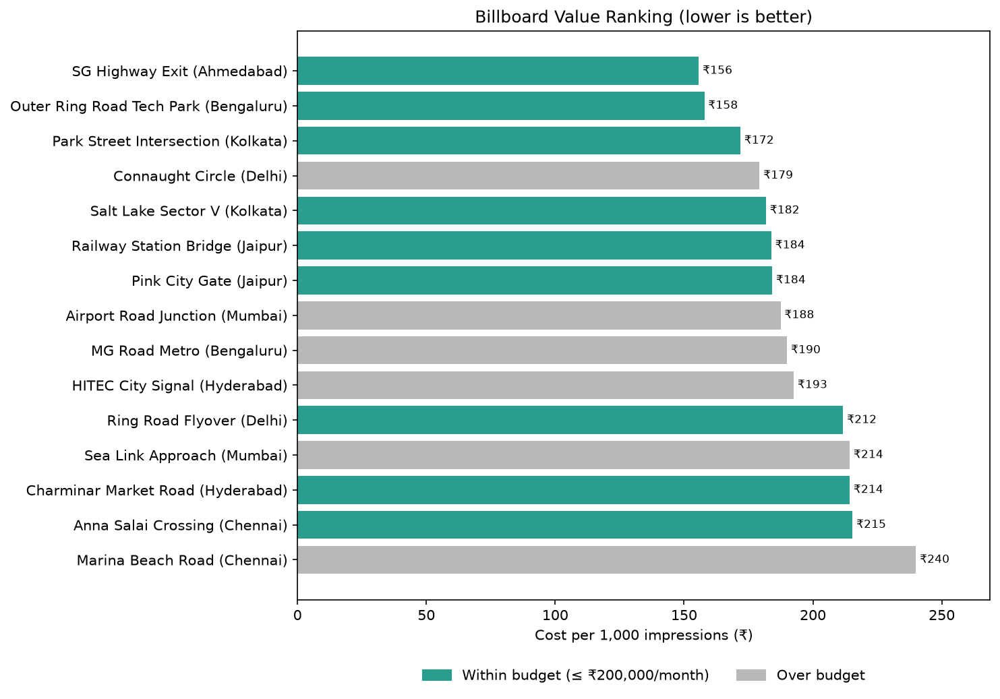

# Billboard Cost Analyzer

A Python script that analyzes a dataset of billboard locations, calculates the **cost per 1,000 impressions (CPM)** for each one, ranks them by value, filters the options that fit a budget, and exports the results to CSV files and a bar chart.

**Tech:** Python, Pandas, Matplotlib



## What it does

1. Loads billboard data from `data/billboards.csv`
2. Cleans it (drops blank, non-numeric, zero or negative cost/impression rows)
3. Calculates CPM: `monthly_cost / monthly_impressions * 1000`
4. Ranks every billboard from best value (lowest CPM) to worst
5. Filters billboards whose monthly cost fits your budget
6. Saves results to the `output/` folder

## Setup

Requires Python 3.9 or newer.

```bash
# 1. (recommended) create a virtual environment
python -m venv venv

# 2. activate it
venv\Scripts\activate          # Windows
source venv/bin/activate       # macOS / Linux

# 3. install the libraries
pip install -r requirements.txt
```

## Usage

```bash
python billboard_analyzer.py                    # default budget
python billboard_analyzer.py --budget 150000    # custom monthly budget
python billboard_analyzer.py --budget 150000 --show   # also pop up the chart
python billboard_analyzer.py --data my_file.csv       # use your own data
```

## Output

| File | Contents |
|------|----------|
| `output/ranked_billboards.csv` | All billboards with CPM and value rank |
| `output/within_budget.csv` | Only billboards at or under the budget (rank is kept from the full list) |
| `output/cpm_chart.png` | Horizontal bar chart of CPM; affordable billboards are highlighted |

## Using your own data

Your CSV needs these columns (extra columns are fine):

`location, city, type, monthly_cost, monthly_impressions`

The included dataset is fictional sample data for demonstration.

## Project structure

```
billboard-cost-analyzer/
├── billboard_analyzer.py    # the program
├── data/
│   └── billboards.csv       # sample dataset
├── output/                  # generated results
├── requirements.txt
└── README.md
```

## Ideas for extending it

- Add a `--city` or `--type` filter (Digital vs Static)
- Pick the best *combination* of billboards for a total campaign budget
- Add unit tests for `add_cpm`, `rank_by_value` and `filter_by_budget` with pytest
- Build a small dashboard on top of the results (Streamlit)
